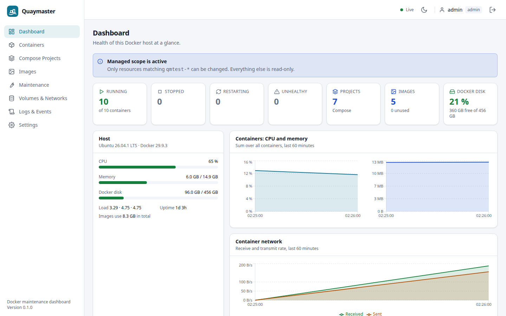
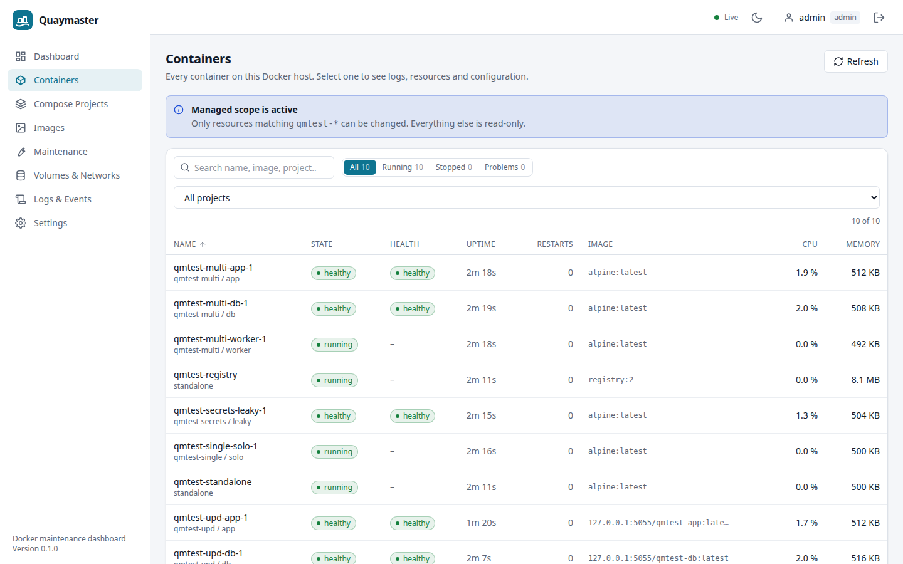
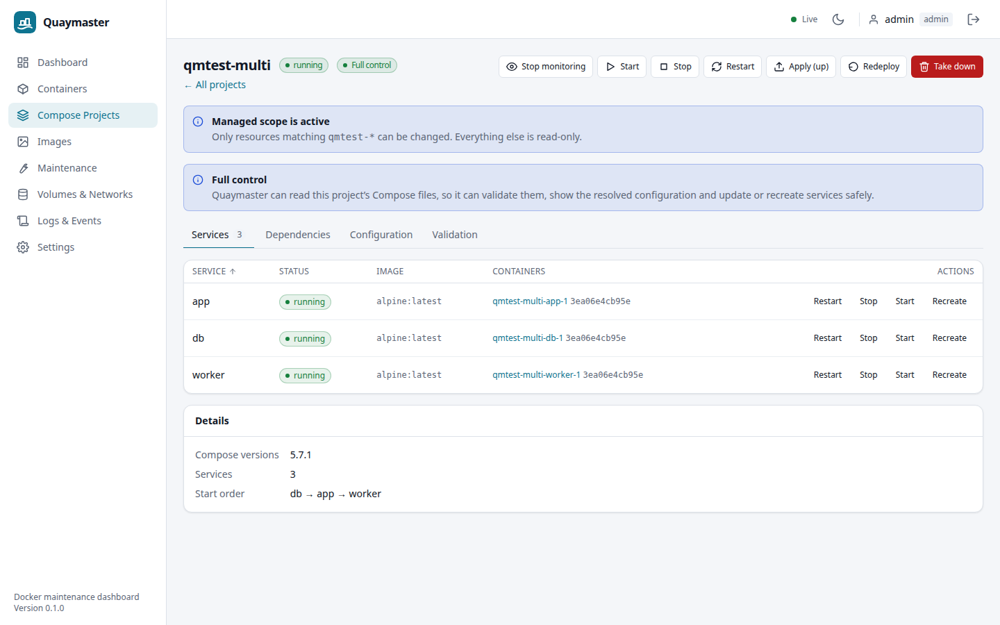
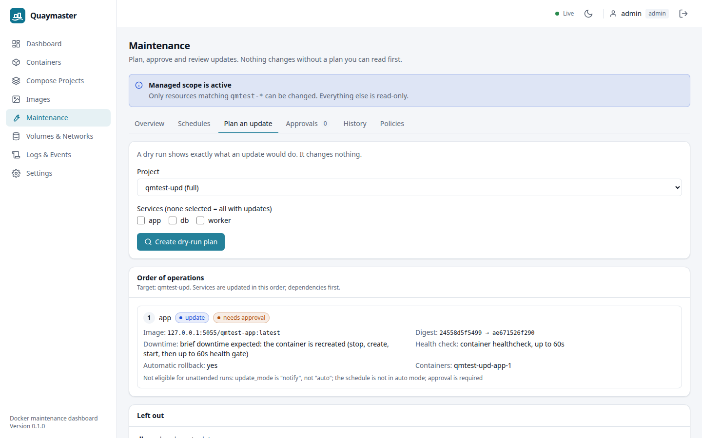
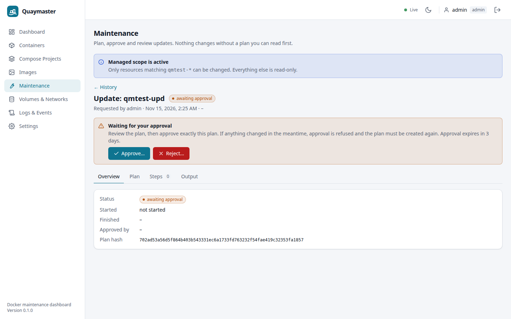
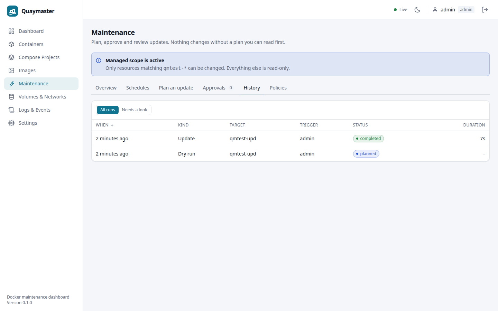
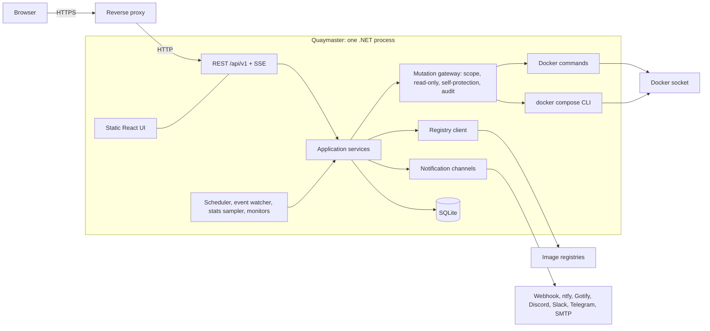

# Quaymaster (.NET)

Quaymaster is a self-hosted web dashboard for monitoring, managing and safely maintaining Docker on a single Linux home
server. It shows containers, Compose projects, images, volumes and networks, and it runs image updates through a controlled
workflow: a dry-run plan, explicit approval, dependency-ordered rollout, health checks, automatic rollback of the image where
that is safe, and an audit trail for everything. Automation is opt-in; the default is to notify and ask.

This repository is the **.NET 10 rebuild** of [Quaymaster](https://github.com/hadieht/quaymaster): a new backend behind the same
`/api/v1` contract, with the original React frontend unchanged.

> **Status: 0.1.0, single host.** Docker socket access is root-equivalent on the host. Read the
> [security model](#security-model) before you deploy. Do not expose Quaymaster to the internet. There is no published image
> yet: you build it from this repository.

|                                                          |                                                            |
| -------------------------------------------------------- | ---------------------------------------------------------- |
|              |              |
|  |  |
|    |            |

More: [container detail](docs/screenshots/container-detail.png), [logs](docs/screenshots/container-logs.png),
[images](docs/screenshots/images.png), [settings](docs/screenshots/settings.png),
[mobile](docs/screenshots/mobile-containers.png). All screenshots show throw-away demo containers.

## Contents

[Features](#features) · [Safe update workflow](#safe-update-workflow) · [Security model](#security-model) ·
[Architecture](#architecture) · [Quick start](#quick-start) · [Native install](#native-install-systemd) ·
[Configuration](#configuration) · [Notification channels](#notification-channels) ·
[Backup and restore](#backup-and-restore) · [Upgrading](#upgrading) · [Troubleshooting](#troubleshooting-and-faq) ·
[Development](#development) · [Limitations](#limitations-and-roadmap) · [License](#license)

More documentation: [INSTALL](docs/INSTALL.md) · [DEPLOY](docs/DEPLOY.md) · [CONFIGURATION](docs/CONFIGURATION.md) ·
[OPERATIONS](docs/OPERATIONS.md) · [MAINTENANCE](docs/MAINTENANCE.md) · [SECURITY-MODEL](docs/SECURITY-MODEL.md) ·
[API](docs/API.md) · [ARCHITECTURE](docs/ARCHITECTURE.md) · [PROGRESS](docs/PROGRESS.md) (build log and known issues)

## Features

- **Dashboard** with host CPU, memory, load, Docker disk usage and free space on the Docker root.
- **Containers:** state, health, ports, mounts, networks, redacted environment and labels, live and historical
  CPU/memory/network/IO, live logs, start/stop/restart/kill/pause/unpause/remove/recreate.
- **Zero-configuration discovery and "stop monitoring":** every Compose project Docker reports is listed with no setup, with
  precise reasons and mount hints for what updates need; admins can remove a project from Quaymaster (typed confirmation,
  never touches Docker) and restore it in Settings.
- **Compose projects:** discovered from container labels, `docker compose ls` and a read-only scan of your stack directories
  (projects that are down stay visible). Dependency graph, validated and redacted resolved config,
  up/stop/start/restart/down/redeploy. Quaymaster never edits your Compose files.
- **Images:** update detection by registry digest (HEAD request, throttled, cached), staged pulls, per-image/tag removal,
  cleanup with a mandatory preview and reclaimed-space report.
- **Volumes and networks:** inventory and usage, plus removal per item or as a bulk "clean up" with a mandatory preview, typed
  confirmation (volumes delete data permanently), server-side re-checks, and a report of the storage actually reclaimed.
- **Maintenance:** policies, maintenance windows, cron schedules, plans (dry run), approvals, run history with per-step
  output, one-click restore of a run's recovery points.
- **Notifications:** webhook (optional HMAC signature), ntfy, Gotify, Discord, Slack, Telegram, SMTP. Per-channel event list
  and minimum severity, de-duplication and cool-down, delivery log with retries.
- **Monitors:** container died/unhealthy/restart loop, updates available, upcoming maintenance, low disk, high CPU/memory.
- **Logs and events:** Docker event history, and an append-only audit log for admins.
- **Users:** `admin` and `viewer` roles. Container log access is a separate per-user permission, off for viewers.
- Light and dark themes, responsive layout, keyboard-accessible tables and dialogs.

## Safe update workflow

An update changes **only the image** of a service. Everything else about the service must already match your Compose files.
Every step of a run is persisted, so you can read afterwards what happened.

1. **Preflight.** Current state of the project; refuse if a service is restarting or unhealthy; check free space on the
   Docker root (fails closed if free space cannot be measured).
2. **Validate.** `docker compose config` must pass. The per-service config hash is compared with the running container. If
   your files drifted from what is running, an automatic run stops (`blocked_drift`). A manual run needs a separate,
   explicit confirmation that shows a redacted diff.
3. **Check.** Registry digests for the affected images.
4. **Recovery point.** The image ID of the running container is recorded and tagged `quaymaster-rollback/…`, so it cannot be
   pruned. Compose file hashes and a redacted config snapshot are stored.
5. **Pull.** By digest, into a `quaymaster-staged/…` tag. The tag you use does not move yet. A failed pull aborts with no
   impact on running containers.
6. **Impact.** Affected services and their dependents, expected downtime, attached volumes, critical flags, and every other
   container on the host that uses the same tag.
7. **Deploy.** One service at a time, dependencies first: `docker compose up -d --no-deps` with `--no-build --pull never`.
   Afterwards the running image ID is asserted.
8. **Health.** Waits for `healthy` if the service has a healthcheck; otherwise for "running, not restarting, restart count
   stable". An optional HTTP probe runs from the server.
9. **Confirm or roll back.** On failure the rollout stops and the remaining services are skipped. If auto-rollback applies, the
   previous image ID is re-tagged, the service is redeployed and health is checked again.
10. **Record and notify.** Result, steps, durations, audit entries, notifications.

**Dry run** runs the read-only steps (preflight, validate, check, impact) and shows the plan. Nothing is pulled or changed.
Every real run stores the plan it executed.

**Approval.** By default a run waits for an admin. The approval is bound to a hash of the plan: if anything in the plan changed
before execution, the run ends `approval_stale` and is never executed. Approvals expire after `QM_APPROVAL_EXPIRY_HOURS`
(default 72).

**Unattended updates** happen only when all four hold: the policy's update mode is `auto`, the schedule's mode is `auto`,
approval is not required, and the target is not marked `critical`. Critical targets always need approval.

### Honest limits

- **Brief downtime.** Compose on one host recreates a container in place. Expect a short interruption per updated service.
  Quaymaster says "brief downtime expected"; it does not claim zero downtime.
- **Rollback restores the image, not the data.** If a new version migrated a database or volume, the old image may not start.
  For services with writable persistent mounts, auto-rollback defaults to **off**: the rollout stops, the service is left as
  is, and you are alerted. Take your own data backup before updating stateful services.
- A crashed run is never resumed. At the next start it is marked `interrupted`, with a critical alert and the exact recovery
  commands if a service was left down. See [docs/OPERATIONS.md](docs/OPERATIONS.md#recovery-after-a-failed-or-interrupted-update).
- Update detection answers "has this tag moved?". It does not suggest newer version tags.
- Services with `build:` or a digest-pinned image are not updated by Quaymaster.
- Standalone containers (no Compose) can be updated by cloning their configuration. This is manual only, API only,
  best-effort, and flagged as such; restoring one is manual.
- Scheduled `image_pull` jobs are accepted but not executed yet.

Task-oriented guide: [docs/MAINTENANCE.md](docs/MAINTENANCE.md).

## Security model

Access to the Docker socket is root-equivalent on the host: whoever controls Quaymaster can start a privileged container.
Quaymaster narrows what it will do, but it cannot make the socket safe.

- Authentication is required for everything except `/healthz` and the login, status and first-run endpoints. There is no
  default password: the first admin is created with a one-time setup token, or from `QM_ADMIN_USER` plus a password hash.
- scrypt password hashing, hashed server-side sessions, `HttpOnly; SameSite=Strict` cookies (`qm_session`, or
  `__Host-qm_session` with `QM_COOKIE_SECURE=true`), CSRF token (`X-QM-CSRF`) plus exact `Origin` check on every
  state-changing request, login rate limiting, strict CSP.
- Every Docker and Compose mutation goes through one gateway that enforces read-only mode, the managed scope, self-protection
  and audit logging. There is no generic Docker API proxy and no route that accepts a command line.
- Secrets in environment variables, labels, Compose config, events, logs and API responses are redacted before they leave the
  process, including secret values learned from other places.
- Notification and registry credentials are encrypted at rest (AES-256-GCM) with a key derived from `QM_SECRET_KEY`.
- Quaymaster refuses to stop, restart, update or remove itself or anything in `QM_PROTECTED`.
- Left out on purpose: container exec/terminal, file browser, editing Compose files, arbitrary hook commands, multi-host agents.

Recommendations: bind to `127.0.0.1` and use a TLS reverse proxy; use `QM_READ_ONLY=true` if you only need monitoring; set
`QM_MANAGED_SCOPE` to limit what can be changed; never expose it to the internet (there is no 2FA). Details and known
limitations: [docs/SECURITY-MODEL.md](docs/SECURITY-MODEL.md). To report a vulnerability: [SECURITY.md](SECURITY.md).

## Architecture



**Stack:** .NET 10 / ASP.NET Core minimal APIs, Clean Architecture (Domain → Application → Infrastructure → Api), EF Core +
SQLite (WAL), `Docker.DotNet.Enhanced` and the `docker compose` CLI; React 18, Vite and Tailwind for the UI (unchanged from the
original); xUnit and Playwright for tests. One process, one container, no external database. See
[docs/ARCHITECTURE.md](docs/ARCHITECTURE.md).

| Path                            | Contents                                                              |
| ------------------------------- | --------------------------------------------------------------------- |
| `src/Quaymaster.Domain`         | Pure domain rules (no framework references)                           |
| `src/Quaymaster.Application`    | Use cases, DTOs, validation, abstractions, background tasks           |
| `src/Quaymaster.Infrastructure` | Docker, Compose CLI, EF Core/SQLite, registry, secrets, notifications |
| `src/Quaymaster.Api`            | Endpoints, middleware, SSE, operator CLI                              |
| `tests/`                        | xUnit unit + integration (`WebApplicationFactory`, fake Docker, live) |
| `web/`, `shared/`               | React frontend and shared API types (from the original, unmodified)   |
| `e2e/`                          | Playwright end-to-end suite (adapted to the .NET server)              |
| `deploy/`                       | systemd unit                                                          |

## Quick start

Requirements: Linux host, Docker Engine with the Compose plugin, and a directory that holds your Compose projects. There is
no published image; the build takes a few minutes.

```bash
# from a checkout of this repository
docker build -t quaymaster-net:dev .

cp .env.example .env && chmod 600 .env
grep -v '^QM_SECRET_KEY=' .env > .env.new
docker run --rm quaymaster-net:dev dotnet /app/Quaymaster.Api.dll gen-secret >> .env.new     # QM_SECRET_KEY=...
mv .env.new .env && chmod 600 .env
# Back up the QM_SECRET_KEY line somewhere outside this server (password manager). Backups do not contain it.

# edit .env: set QM_STACK_PATHS (e.g. /opt/stacks) and review the example values (see docs/CONFIGURATION.md)
# add the same directory to the volumes of docker-compose.yml:   - /opt/stacks:/opt/stacks

export DOCKER_GID=$(stat -c %g /var/run/docker.sock)      # the compose file needs it on every compose command
docker compose up -d --build
docker logs quaymaster-net 2>&1 | grep -A2 "first-run setup"      # the one-time setup token
```

Open `http://127.0.0.1:8787`, enter the setup token and create the admin account (password: at least 12 characters). The port
is bound to `127.0.0.1` by default. For access from other machines put a TLS reverse proxy in front and set
`QM_PUBLIC_ORIGIN`, `QM_COOKIE_SECURE` and `QM_TRUST_PROXY` ([INSTALL.md](docs/INSTALL.md#5-reverse-proxy-and-tls-recommended)).
Opening the UI by a LAN IP or host name **requires** `QM_PUBLIC_ORIGIN`; so does publishing on a port other than 8787.

To skip the setup token, set `QM_ADMIN_USER` and `QM_ADMIN_PASSWORD_HASH` in `.env` before the first start. Generate the hash
with `docker run --rm -it quaymaster-net:dev dotnet /app/Quaymaster.Api.dll hash-password` (hidden prompt) and paste the line
as printed (the single quotes matter: the hash contains `$`).

Add `QM_READ_ONLY=true` to try Quaymaster in monitoring-only mode first. Full instructions: [docs/INSTALL.md](docs/INSTALL.md);
what the image and compose file contain: [docs/DEPLOY.md](docs/DEPLOY.md).

## Native install (systemd)

Quaymaster can run on the host as a dedicated `quaymaster` user in the `docker` group, using
[`deploy/quaymaster-net.service`](deploy/quaymaster-net.service). It needs the ASP.NET Core 10 runtime and the Docker CLI with
the Compose plugin; building needs the .NET 10 SDK and Node.js 22+. Steps:
[docs/INSTALL.md](docs/INSTALL.md#native-install-systemd).

## Configuration

Quaymaster is configured through `QM_*` environment variables only. Unknown `QM_*` names are rejected at start-up (typo
protection), all problems are reported at once, and invalid values stop the server (exit code 2) with a message that names the
variable. A secret key is required. [`.env.example`](.env.example) lists everything (read its
[cautions](docs/CONFIGURATION.md#cautions-about-envexample)); [docs/CONFIGURATION.md](docs/CONFIGURATION.md) explains each
variable and its range.

| Variable                      | Default                  | Purpose                                                                                                 |
| ----------------------------- | ------------------------ | ------------------------------------------------------------------------------------------------------- |
| `QM_HOST`                     | `127.0.0.1`              | Bind address. The container image sets `0.0.0.0`; exposure is then set by the port mapping.             |
| `QM_PORT`                     | `8787`                   | Listen port.                                                                                            |
| `QM_PUBLIC_ORIGIN`            | derived from host/port   | Exact browser origin(s), comma-separated, for the CSRF `Origin` check. Replaces the default.            |
| `QM_TRUST_PROXY`              | empty                    | IPs/CIDRs of reverse proxies whose `X-Forwarded-For` is trusted. `true`, `*`, `0.0.0.0/0` are rejected. |
| `QM_COOKIE_SECURE`            | `false`                  | Set `true` behind HTTPS: `Secure` cookie, `__Host-` prefix, HSTS.                                       |
| `QM_DATA_DIR`                 | `./data`                 | Database, lock file, setup token. `/var/lib/quaymaster-net` in the image.                               |
| `QM_SECRET_KEY`               | none                     | **Required** (or `QM_SECRET_KEY_FILE`). At least 32 random bytes, hex or base64.                        |
| `QM_SECRET_KEY_FILE`          | none                     | File containing the key.                                                                                |
| `QM_ADMIN_USER`               | none                     | First admin name; used only while there are no users.                                                   |
| `QM_ADMIN_PASSWORD_HASH`      | none                     | scrypt hash for that admin. Not together with the file variant.                                         |
| `QM_ADMIN_PASSWORD_FILE`      | none                     | File with a plain password, hashed at first start.                                                      |
| `QM_DOCKER_SOCKET`            | `/var/run/docker.sock`   | Socket path, or `tcp://host:port` for a socket proxy.                                                   |
| `QM_DOCKER_BIN`               | `docker`                 | Docker CLI used for Compose.                                                                            |
| `QM_STACK_PATHS`              | none                     | Absolute directories where update/redeploy/config may run. Optional; discovery needs none.              |
| `QM_STACK_AUTO_MOUNTS`        | `true`                   | Treat same-path bind mounts of Quaymaster's own container as allowed stack roots.                       |
| `QM_DOCKER_ROOT_MOUNT`        | none                     | A directory on the Docker root's filesystem, for free-space checks.                                     |
| `QM_READ_ONLY`                | `false`                  | Disable every mutating action.                                                                          |
| `QM_MANAGED_SCOPE`            | empty (all)              | Name globs that may be mutated.                                                                         |
| `QM_VISIBLE_SCOPE`            | empty (all)              | Name globs of resources that are visible at all (demos, screenshots).                                   |
| `QM_PROTECTED`                | empty                    | Names that are never mutated (reverse proxy, socket proxy).                                             |
| `QM_SELF_CONTAINER`           | auto-detected            | Name or ID of Quaymaster's own container.                                                               |
| `QM_REDACT_ALL_ENV`           | `false`                  | Mask every environment value.                                                                           |
| `QM_HELPER_ENABLED`           | `true`                   | Accepted, no effect (the original's file helper is not ported).                                         |
| `QM_HELPER_IMAGE`             | none                     | Accepted, no effect.                                                                                    |
| `QM_HELPER_LABELS`            | none                     | Accepted, no effect.                                                                                    |
| `QM_SESSION_IDLE_MINUTES`     | `30`                     | Idle session timeout.                                                                                   |
| `QM_SESSION_ABSOLUTE_HOURS`   | `12`                     | Absolute session lifetime.                                                                              |
| `QM_SSE_MAX_PER_SESSION`      | `8`                      | Live streams per session.                                                                               |
| `QM_SSE_MAX_TOTAL`            | `32`                     | Live streams in total.                                                                                  |
| `QM_LOG_FOLLOW_BYTES_PER_SEC` | `524288`                 | Rate cap for log follow streams.                                                                        |
| `QM_SCRYPT_LOG2_N`            | `17`                     | scrypt cost (log2 N). Below 14 only in the Testing environment.                                         |
| `QM_STATS_INTERVAL_SECONDS`   | `10`                     | Stats sampling interval.                                                                                |
| `QM_STATS_RETENTION_HOURS`    | `48`                     | Stats retention.                                                                                        |
| `QM_EVENT_RETENTION_DAYS`     | `14`                     | Docker event retention.                                                                                 |
| `QM_AUDIT_RETENTION_DAYS`     | `365`                    | Audit retention. Minimum 30.                                                                            |
| `QM_DISK_FLOOR_BYTES`         | `5368709120`             | Free space that must remain on the Docker root when pulling.                                            |
| `QM_DF_MIN_INTERVAL_SECONDS`  | `21600`                  | Minimum interval between `system df` runs.                                                              |
| `QM_LOG_LEVEL`                | `info`                   | `fatal`, `error`, `warn`, `info`, `debug`, `trace`, `silent`.                                           |
| `QM_DISABLE_BACKGROUND`       | `false`                  | Skip all background tasks (diagnostics only).                                                           |
| `QM_WEB_DIR`                  | `<working dir>/web/dist` | Directory with the built web UI. Unset and missing = API only.                                          |
| `QM_REGISTRY_INSECURE`        | empty                    | Registry hosts (`host[:port]`) allowed over plain HTTP.                                                 |
| `QM_REGISTRY_TOKEN_REALMS`    | none                     | Extra `registry.host=token.host` pairs for token authentication.                                        |
| `QM_CHECK_TTL_MINUTES`        | `360`                    | Cache lifetime of registry checks.                                                                      |
| `QM_ROLLBACK_RETENTION_DAYS`  | `7`                      | How long rollback images are kept.                                                                      |
| `QM_CLEANUP_MIN_AGE_HOURS`    | `24`                     | Cleanup never touches younger items.                                                                    |
| `QM_APPROVAL_EXPIRY_HOURS`    | `72`                     | Approvals expire after this.                                                                            |

`DOCKER_GID`, `DEPLOY_BIND`, `DEPLOY_PORT` and `DEPLOY_IMAGE` are read by `docker-compose.yml`, not by Quaymaster.

### Stack directories at identical paths

Docker interprets bind-mount paths on the host, and Compose resolves relative paths against the project directory. In
container mode each stack directory must therefore appear inside the container at the **same absolute path** as on the host:
list it in `QM_STACK_PATHS` and add `- /opt/stacks:/opt/stacks` to the `volumes:` of `docker-compose.yml`. Add `:ro` for
monitoring only. A project whose files Quaymaster cannot read or trust is shown as **limited**: status, logs and
start/stop/restart still work, redeploy and update are off.

## Notification channels

Add channels under **Settings → Notifications** and use **Test** to send a test event.

| Channel        | Fields                                                                                                                   |
| -------------- | ------------------------------------------------------------------------------------------------------------------------ |
| Webhook        | `url`; optional `secret` (adds `X-Quaymaster-Signature` and `X-Quaymaster-Timestamp` headers), optional custom `headers` |
| ntfy           | `serverUrl`, `topic`; optional `token`                                                                                   |
| Gotify         | `serverUrl`, `appToken`                                                                                                  |
| Discord, Slack | incoming-webhook `url`                                                                                                   |
| Telegram       | `botToken`, `chatId`; optional `apiBase`                                                                                 |
| SMTP           | `host`, `port`, `from`, `to` (list); optional `secure`, `username`, `password`                                           |

Each channel has a minimum severity (`info`, `warning`, `critical`) and an event list. Channel configuration is stored
encrypted, and secrets and URLs are never returned. Outbound requests refuse link-local and cloud-metadata addresses; LAN
targets are allowed. Failed deliveries are retried five times with back-off, then marked dead.

## Backup and restore

State lives in one SQLite file, `<QM_DATA_DIR>/quaymaster.db`. **There is no `backup` command in the CLI** (the original had
one); use SQLite's online backup on the host, or stop Quaymaster and copy the files:

```bash
DATA=$(docker volume inspect quaymaster-net_qmdata --format '{{.Mountpoint}}')
sudo sqlite3 "$DATA/quaymaster.db" ".backup '/var/backups/quaymaster-$(date +%F).db'"
sudo chmod 600 /var/backups/quaymaster-$(date +%F).db
```

**Back up `QM_SECRET_KEY` separately.** It is not in the database. Without it, stored notification and registry credentials
cannot be decrypted. Restoring requires Quaymaster to be stopped; the tested procedure is in
[docs/OPERATIONS.md](docs/OPERATIONS.md#restore).

## Upgrading

Back up, update the checkout, then `docker compose up -d --build`. Schema migrations are forward-only and run automatically at
start-up (a `backup-pre-<migration>.db` copy is written first); the server refuses to start on a database written by a newer
build. See [docs/OPERATIONS.md](docs/OPERATIONS.md#upgrading).

## Troubleshooting and FAQ

**The container restarts in a loop, or the server exits at start-up.** Run `docker logs quaymaster-net`. A configuration
problem prints `Invalid configuration:` with one line per problem (missing `QM_SECRET_KEY`, a weak key, an unknown `QM_*` name,
a malformed `QM_TRUST_PROXY`, a relative `QM_STACK_PATHS`) and exit code 2. Fix `.env`, then recreate the container with
`docker compose up -d --force-recreate` (`.env` is only read when the container is created).

**`Another Quaymaster instance is using <dir>`.** Two processes share one data directory. Stop the other one.

**`Database schema ... is newer than this build supports`.** The database was written by a newer build. Use that build or
restore an older backup.

**A project is "limited".** Quaymaster cannot read the Compose files at their recorded path, they are outside the allowed
roots, or the labels disagree. Mount the directory at the identical path and list it in `QM_STACK_PATHS`. The project page
shows the exact reason.

**Login fails with 403, or the UI reports an origin/CSRF error (`Missing or unexpected Origin header`).** `QM_PUBLIC_ORIGIN`
must equal the address in the browser's address bar, scheme and port included. It is required for any LAN IP, host name,
Tailscale address, TLS proxy address, or a published port other than 8787. List every address you use, comma-separated, then
recreate the container: `QM_PUBLIC_ORIGIN=http://127.0.0.1:8787,http://192.168.1.50:8787`.

**Login returns 429 for everyone.** You are behind a proxy without `QM_TRUST_PROXY`. Set it to the proxy's address. After five
wrong passwords for one account from one address the pair is locked for 30 seconds, doubling up to 15 minutes; a restart clears
the counters.

**`required variable DOCKER_GID is missing a value`.** Run `export DOCKER_GID=$(stat -c %g /var/run/docker.sock)` (or put
`DOCKER_GID=...` into `.env`); every `docker compose` command in this directory needs it.

**"Permission denied" on the Docker socket.** `DOCKER_GID` is wrong. Use `stat -c %g /var/run/docker.sock`.

**Reads answer `docker_unavailable` (503).** The daemon is not reachable on `QM_DOCKER_SOCKET`. Quaymaster keeps running and
reconnects.

**Mutations are refused with `read_only` although `QM_READ_ONLY` is not set.** Quaymaster runs in a container and could not
identify it (`QM_VISIBLE_SCOPE` may hide it). Set `QM_SELF_CONTAINER` to the container's name and keep it visible.

**A plan is blocked with `blocked_drift`.** The Compose files no longer match the running container (someone edited them, or
an environment variable they use changed). Review the redacted diff, then either redeploy deliberately or revert the edit.

**An update is refused: not enough disk space, or free space unknown.** Set `QM_DOCKER_ROOT_MOUNT` to a directory on the Docker
root's filesystem (see [docs/INSTALL.md](docs/INSTALL.md#optional-free-space-checks)). Without a reading the check fails closed.

**The log shows `First/FirstOrDefault` warnings from Entity Framework.** Cosmetic; known (see PROGRESS).

**Can I monitor without giving it the Docker socket?** Not with a shipped example. `QM_READ_ONLY=true` stops all changes, and
`QM_DOCKER_SOCKET=tcp://...` can point at a read-only socket proxy, but that arrangement is not covered by an example or test here.

**Does it update itself?** No. It refuses to touch its own container. Upgrade it as described above.

**I lost the admin password.** There is no reset command. See [docs/OPERATIONS.md](docs/OPERATIONS.md#lost-admin-access).

## Development

Requires the .NET 10 SDK, Node.js 22+, Docker with Compose, and a local `alpine` image for the live tests. The .NET server
serves the built SPA itself from `QM_WEB_DIR`.

**A. Hot-reloading UI (two processes)**

```sh
npm install
# terminal 1: API on 127.0.0.1:8787, data in $PWD/.local/dev-data (use an absolute path: relative ones resolve against src/Quaymaster.Api)
QM_DATA_DIR="$PWD/.local/dev-data" QM_SECRET_KEY="$(openssl rand -base64 32)" \
  dotnet run --project src/Quaymaster.Api --no-launch-profile
# terminal 2: Vite on http://127.0.0.1:5173, proxies /api to the API
npm run dev -w web
```

If the API listens elsewhere set `QM_DEV_API=http://127.0.0.1:<port>` for the Vite process. Open the Vite URL (5173).

**B. Production-like (single process, built SPA)**

```sh
npm run build                      # shared + web -> web/dist
QM_WEB_DIR="$PWD/web/dist" QM_DATA_DIR="$PWD/.local/dev-data" QM_SECRET_KEY="$(openssl rand -base64 32)" \
  dotnet run --project src/Quaymaster.Api --no-launch-profile   # http://127.0.0.1:8787
```

First run: the server prints a one-time setup token (also in `<data>/setup-token`). Operator commands:
`dotnet run --project src/Quaymaster.Api --no-launch-profile -- gen-secret` and `-- hash-password 'a long password'`.

### Tests

```sh
dotnet test                              # unit + integration (Category=Live tests need the local Docker daemon)
dotnet test --filter "Category!=Live"    # without a Docker daemon
npm run build && npm run e2e             # Playwright against the .NET server and test-fixtures/ (qmtest-* only)
npm run screenshots                      # regenerates docs/screenshots/*.png from a neutral fixture copy
```

`e2e/run.sh` builds the API, starts the fixture stacks, runs the server on `127.0.0.1:${E2E_PORT:-8791}` with
`QM_MANAGED_SCOPE=QM_VISIBLE_SCOPE=qmtest-*`, runs Playwright, and tears everything down on exit. Prerequisites: `npm run
build`, Docker, the local `alpine` image, `npx playwright install chromium`. Check for leftovers with
`docker ps -a --filter label=quaymaster.test=true` (must be empty). Integration and end-to-end tests create **only**
`qmtest-*` resources labelled `quaymaster.test=true`; any instance you start while developing must run with
`QM_MANAGED_SCOPE=qmtest-*` and bind to `127.0.0.1`.

## Limitations and roadmap

Known limitations in 0.1.0:

- Single host only; no multi-host agents.
- No two-factor authentication. Do not expose it to the internet.
- No exec/terminal, file browser or Compose file editor.
- Update detection is digest-based; no newer-version suggestions.
- Compose `build:` services and digest-pinned images are not updated.
- Login rate-limit state and notification cool-downs are in memory and reset by a restart.
- No admin password-reset command, and no `backup`/`restore`/`check` CLI subcommands (use `sqlite3`, see above).
- The original's read-only file-helper container is not ported: projects Quaymaster cannot read show no configuration;
  `QM_HELPER_*` have no effect.
- Scheduled `image_pull` jobs are accepted but not executed. `GET /stream/maintenance` is polled (2 s) and not used by the UI.
- Standalone-container updates are manual, API only and best-effort; restoring one is manual, and `-qm-old-*` containers are
  not pruned automatically.
- No published image, socket-proxy or reverse-proxy example files in this repository yet.
- Read-only mode is enforced in the mutation gateway, not in the Docker HTTP transport.
- The CI workflow has not run on GitHub. The last full local test run recorded in [PROGRESS](docs/PROGRESS.md) was 648 unit and
  289 integration tests (including live tests); fixes made afterwards were verified by their own regression tests.
- Low-severity red-team findings were accepted and are listed in PROGRESS (T8) and the
  [security model](docs/SECURITY-MODEL.md#known-limitations).

Roadmap (not committed): TOTP, persistent rate-limiter state, a backup/restore and admin-recovery CLI, newer-tag suggestions,
`image_pull` execution, published images.

## License

MIT. See [LICENSE](LICENSE).
