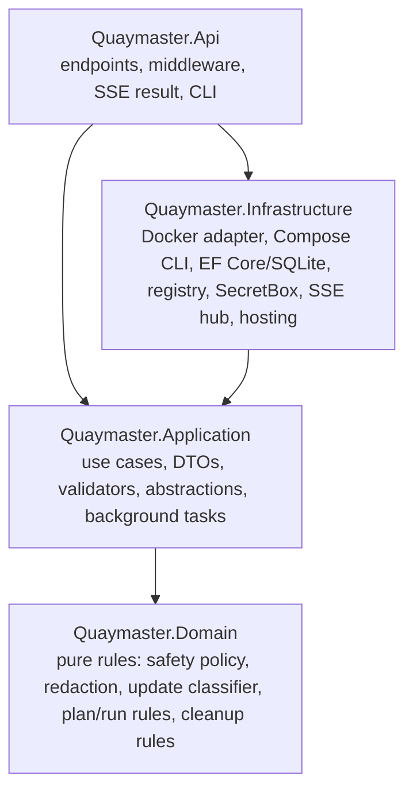
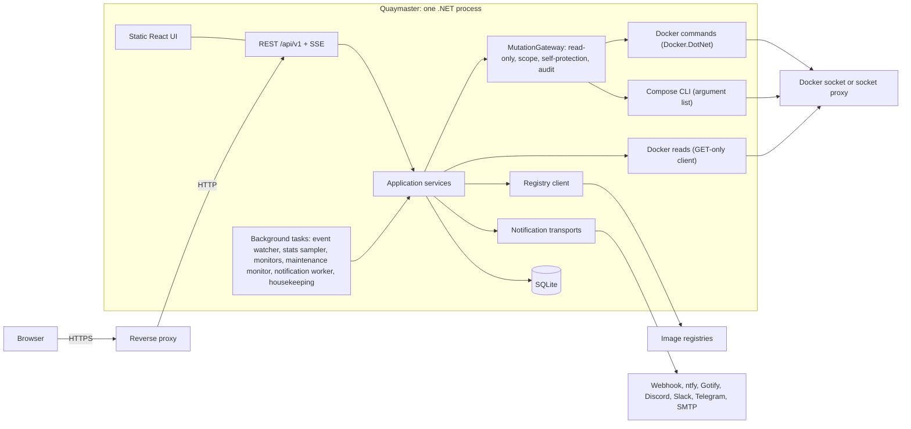
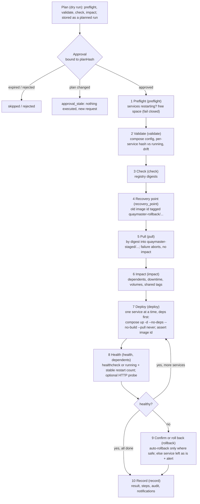

# Architecture

How Quaymaster (.NET) is put together: the layers, the pieces that matter for safety, the update engine's lifecycle, how
live streams work, and what is stored. For the security rules see [SECURITY-MODEL.md](SECURITY-MODEL.md); for the wire
format see [API.md](API.md).

Design priorities, in order: **safety, reliability, security, usability, feature breadth.** When in doubt, do less and say so
in the UI. The product, wire format and web UI are those of the original Node.js Quaymaster; this document describes the
new backend.

## Technology

| Layer        | Choice                                                                                                                       |
| ------------ | ---------------------------------------------------------------------------------------------------------------------------- |
| Language     | C# on .NET 10, nullable on, warnings as errors, analyzers enforced (`.editorconfig`, `Directory.Build.props`)                |
| HTTP         | ASP.NET Core minimal APIs, Kestrel; hand-written middleware for auth, CSRF and headers                                       |
| Validation   | FluentValidation, with messages and shapes matching the original's zod errors                                                |
| Docker       | `Docker.DotNet.Enhanced` 4.4.1 for lifecycle commands, ping and pull; a small GET-only socket client for inspect/list/events |
| Compose      | the `docker compose` CLI, started with an argument list (no shell)                                                           |
| Storage      | SQLite through EF Core 10 (WAL), one baseline migration, parameterised SQL over the baseline tables for most stores          |
| Crypto       | scrypt (BouncyCastle), AES-256-GCM with HKDF-SHA256 (framework)                                                              |
| Frontend     | React 18 + Vite, **unmodified** from the original; served from `QM_WEB_DIR`                                                  |
| Live updates | Server-Sent Events                                                                                                           |
| Packaging    | one container image (API + static UI on one port), or a published folder under systemd                                       |
| Tests        | xUnit (unit, integration through `WebApplicationFactory`, `Live` category against a real daemon), Playwright (e2e)           |

## Layers

Dependencies point inward. Domain knows nothing; Api knows everything.

| Project                         | Holds                                                                                                                                                                                                                                                                                                                                                                    |
| ------------------------------- | ------------------------------------------------------------------------------------------------------------------------------------------------------------------------------------------------------------------------------------------------------------------------------------------------------------------------------------------------------------------------ |
| `src/Quaymaster.Domain`         | Pure code with no I/O and no framework references: `SafetyPolicy` (read-only, scope, self-protection decisions), `Redactor`/`Scrubber`, `UpdateClassifier` (the six-state digest machine), image reference parsing, `DependencyGraph`, plan/run/policy/schedule rules and DST-safe `TimeMath`, cleanup and reclaim rules, outbound URL policy, `LastAdminRule`.          |
| `src/Quaymaster.Application`    | Use-case services (`SessionService`, `ContainerService`, `ComposeService`, `UpdateService`, `PlannerService`, `RunService`, `RunExecutor`, `NotificationService` ...), DTOs, validators, `QmConfigLoader`, the error model, and the abstractions Infrastructure implements (`IDockerEngine`, `IDockerCommands`, `IComposeCli`, stores, `ISecretBox`, `IRegistryClient`). |
| `src/Quaymaster.Infrastructure` | Adapters: Docker (`DockerEngineAdapter`, `DockerHttp`), `ComposeCli`, `StackFiles`, EF Core `AppDbContext` and SQL repositories, `ScryptPasswordHasher`, `SecretBox`, `RegistryClient`, notification transports, `SseHub`, background host, instance lock.                                                                                                               |
| `src/Quaymaster.Api`            | Only wiring: one static `Map(RouteGroupBuilder)` per endpoint group, middleware, `SseResult`, the operator CLI. No business logic.                                                                                                                                                                                                                                       |
| `tests/`                        | `Quaymaster.UnitTests`, `Quaymaster.IntegrationTests` (with an in-memory `FakeDocker` world and `Live` tests that use a real daemon and `qmtest-*` resources only).                                                                                                                                                                                                      |

Layering is enforced by the project references and by an architecture test (see the gateway below).

### Request pipeline

Middleware order (`Program.cs`):

1. **ExceptionHandling:** every exception becomes the error envelope; 5xx never leaks a message or stack trace.
2. **ForwardedHeaders** (only with `QM_TRUST_PROXY`): the client IP from `X-Forwarded-For` of trusted proxies.
3. **SecurityHeaders:** CSP and friends, HSTS when `QM_COOKIE_SECURE`, `no-store` for the API.
4. **StaticFiles:** the React build (before routing; stands down when the SPA fallback is selected).
5. **Routing**, then **ResponseScrub** (learned-secret scrub of JSON `/api/v1` responses).
6. **ApiGuard:** for `/api/*`, session authentication (401), exact `Origin` (403 `origin`) and `X-QM-CSRF` (403 `csrf`) on
   state-changing requests. Fail-closed: only four paths are public.
7. **Endpoints:** `/healthz`, `/api/v1/*`, the unknown-route envelope (`not_found`) and the SPA fallback (GET without a file
   extension returns `index.html`).

Rate limiting for login and setup runs inside the use cases, after body validation and before password hashing, because it
is keyed on account and IP. Capability checks (admin, logs) are route-group filters (`RequireCapability`).

Endpoint conventions: bodies are read with `StrictJsonBody` (a record of nullable fields plus a validator; unknown
properties are rejected); errors are thrown as `AppException` with an `ErrorCode`; every mutation is audited.

## Runtime view

One process, one container, no external database. A second instance on the same data directory is refused (an OS file lock
on `quaymaster.lock`).

### Key abstractions

| Abstraction                                                        | Role                                                                                                                                                                                                                                                                                                        |
| ------------------------------------------------------------------ | ----------------------------------------------------------------------------------------------------------------------------------------------------------------------------------------------------------------------------------------------------------------------------------------------------------- |
| `IMutationGateway` / `MutationGateway`                             | **The only class allowed to use `IDockerCommands` and `IComposeCli`** (checked by an architecture test, which also checks that endpoints never touch the engine directly). Every mutation passes read-only mode, managed scope, self-protection, the maintenance gate, and is audited.                      |
| `SafetyPolicy` (Domain)                                            | Pure decision logic behind the gateway: `ContainerRefusal`, `ProjectRefusal`, visibility, glob matching. Fails closed to read-only when running in a container that cannot identify itself.                                                                                                                 |
| `IDockerEngine` (reads), `IDockerCommands`                         | Reads and mutations are separate interfaces; the read interface has no mutating members (tested).                                                                                                                                                                                                           |
| `DockerBootstrap`                                                  | Lazy, retried initialisation that needs the daemon: API version negotiation (min of daemon and 1.55, refuses < 1.40), self-detection, Docker root, same-path mount roots. A daemon that is down at start does not stop the app.                                                                             |
| `IOperationManager`                                                | Long actions (Compose actions, pulls, runs, restores) return an `operationId` with 202; output is scrubbed, stored (newest 256 KiB) and streamed. Locks per key (for instance one `maintenance` run at a time). Operations left `running` by a crash are marked failed/interrupted at start, never resumed. |
| `IUpdateService`, `IRegistryClient`                                | Update detection by digest (HEAD, throttled, cached), the six-state classifier, quarantine.                                                                                                                                                                                                                 |
| `IPlanService`, `IRunService`, `RunExecutor`, `StandaloneExecutor` | Dry-run plan, run creation/approval/rejection/restore, the executor, and the standalone config-clone updater.                                                                                                                                                                                               |
| `INotificationSink`                                                | Outbound seam for monitors and the engine: events go to the dispatcher with de-duplication, cool-down, retries and a delivery log.                                                                                                                                                                          |
| `ISecretBox`                                                       | AES-256-GCM encrypt/decrypt for stored secrets; the key is derived from `QM_SECRET_KEY` and never stored.                                                                                                                                                                                                   |
| `ISseHub`, `ISseConnection`                                        | Registry of live streams bound to sessions; per-stream frame queue with back-pressure.                                                                                                                                                                                                                      |
| `IQMBackgroundTask`, `QmBackgroundHost`                            | Background work: failure-isolated, restarted with back-off (5 s doubling to 5 min) when a task crashes, skipped with `QM_DISABLE_BACKGROUND`.                                                                                                                                                               |

Background tasks: `docker-events` (event watcher), `stats-sampler`, `monitors` (container/host alerts), `maintenance-monitor`
(scheduler, approval expiry, upcoming/updates/disk alerts, 60 s tick), `notifications` (delivery worker), `retention`, and
`housekeeping` (expired sessions, audit retention, WAL checkpoint every 10 minutes).

### Compose project capability levels

| Level        | When                                                                                   | What works                                                                                                              |
| ------------ | -------------------------------------------------------------------------------------- | ----------------------------------------------------------------------------------------------------------------------- |
| `full`       | Compose files readable, under an allowed root (`QM_STACK_PATHS` or a same-path mount)  | Everything: validate, resolved config, up/stop/start/restart/down/redeploy, updates.                                    |
| `limited`    | Files missing, unreadable, untrusted, outside the allowed roots, or label disagreement | Status, logs, start/stop/restart through the Engine API. The reasons and the mount hint are listed on the project page. |
| `standalone` | Containers without Compose labels                                                      | Container actions; manual config-clone update.                                                                          |

The original's read-only file-helper container (which showed redacted configs of `limited` projects) is **not** ported.

## Update engine lifecycle

Every real run stores the plan it executes and persists each step (`runs`, `run_steps`, write-ahead `intents`). The ten
steps, with the persisted step names in parentheses:

Rules that shape the diagram:

- **An update changes only the image.** Drift between the Compose files and the running containers blocks automatic runs
  (`blocked_drift`); a manual run needs an explicit "apply drift" confirmation.
- **Pull is not deploy.** Images are pulled by digest and staged; the user-visible tag moves only inside the deploy step.
- **Unattended** only when the policy mode is `auto`, the schedule mode is `auto`, approval is not required and the target is
  not `critical`. Standalone containers are never unattended.
- **Auto-rollback** re-tags the recorded previous image id, redeploys the service and re-verifies health. It is **off** by
  default for services with writable persistent mounts (the old image may not start on migrated data); then the rollout
  stops, the service is left as is, remaining services are `skipped`, and a `service.left_down` alert is raised if needed.
- **Crashes:** startup recovery marks in-flight runs `interrupted` with exact recovery commands. They are never resumed.
- **Serialisation:** one maintenance run at a time; overlapping starts are declined/serialised (`run.conflict`). The run
  lock is released just before the terminal status is published, so a client that sees `completed` can immediately start the
  next run.
- **Window:** update steps only start while the window is open; a window that closes mid-run ends the run `partial`.
- **Fences:** a plan refuses protected/self/out-of-scope dependents, and the executor asserts the project and every
  container of the service (hidden ones included) before every `compose up`, including rollback and restore.
- **Post-deploy reads are fresh.** The executor never joins an in-flight container-list fetch, and waits (bounded) for the
  expected number of new container ids. Docker errors in these checks count as failed health checks and lead to the
  rollback/guidance path. The terminal run status write is retried, so a run cannot stay `running`.
- **Run statuses:** `planned`, `awaiting_approval`, `approved`, `running`, `completed`, `failed`, `partial`, `rolled_back`,
  `skipped`, `interrupted`, `approval_stale`, `blocked`, `rejected`.

**Standalone updates** (`StandaloneExecutor`, manual, API only) do not use Compose: recovery point, pull by digest, create a
stopped clone from the configuration that differs from the old image's own (all mounts and networks carried), stop the old
container, set its restart policy to `no`, rename it `<name>-qm-old-<epoch>`, rename the clone, start it, health-gate it;
any failure undoes the steps. There is no restore endpoint; the run's `reason` carries the manual commands.

**Scheduler.** Cron expressions are evaluated in IANA time zones (DST-safe, tested for Europe/Berlin and Australia/Sydney).
The cursor moves _before_ firing (at-most-once per occurrence); missed occurrences older than five minutes are skipped
unless they are the latest one of an `update` job with an open window. `image_pull` schedules are accepted but **not yet
executed**.

## Live streams (SSE)

Streams are `text/event-stream` responses over `GET /api/v1/stream/...`. Each is a connection owned by the session that
opened it:

- **Admission:** `ISseHub.Open` refuses with 429 when the session already has `QM_SSE_MAX_PER_SESSION` streams (default 8) or
  the process has `QM_SSE_MAX_TOTAL` (default 32).
- **Lifetime:** closed with `end {reason}` on logout, session expiry, password change, role change or disabling the user
  (`ISessionRevocationBus`); re-validated every 60 seconds; closed at the session's absolute expiry.
- **Back-pressure:** frames queue per connection; above 1 MiB queued the stream is closed with reason "client too slow;
  reconnect". Heartbeat comments (`: ping`) every 15 seconds keep proxies from timing out.
- **Sources:** events and stats are broadcast from background tasks (`Broadcaster<T>`); logs follow the container with a
  per-stream byte-rate cap (`QM_LOG_FOLLOW_BYTES_PER_SEC`); operation output comes from `IOperationManager`;
  `/stream/maintenance` is **polled every 2 seconds** (snapshot, then `run` on change), not pushed.
- Event names: `docker-event`, `snapshot`, `stats`, `log`, `output`, `status`, `run`, `error`, `end`
  (details in [API.md](API.md)).
- Streams are not covered by the JSON response scrub; their content is scrubbed at the source.

## Data model

One SQLite file, `<QM_DATA_DIR>/quaymaster.db`, WAL mode, `synchronous=NORMAL`, foreign keys on, `busy_timeout` 5000 ms. The
data directory is created with mode 0700 and the database with 0600. Times are epoch milliseconds. The schema is a single
**Baseline** EF migration that reproduces the original server's complete schema (24 tables, CHECK constraints, `COLLATE
NOCASE`, `WITHOUT ROWID` where used) idempotently, so that the table layout is identical to the original. Later migrations
are forward-only; a pre-migration `VACUUM INTO` copy (`backup-pre-<migration>.db`) is taken for an existing database, and a
database newer than the build refuses to start.

| Area          | Tables                                                                                   | Notes                                                                                                                                            |
| ------------- | ---------------------------------------------------------------------------------------- | ------------------------------------------------------------------------------------------------------------------------------------------------ |
| Identity      | `users`, `sessions`                                                                      | Role `admin`/`viewer`; session id stored as SHA-256; per-session CSRF secret; sessions cascade-delete with the user.                             |
| Audit         | `audit_log`                                                                              | Append-only by trigger (no update; no delete of rows younger than 30 days).                                                                      |
| Docker state  | `events`, `stats_rollups`, `operations`, `intents`, `ignored_targets`                    | Event history, one-minute roll-ups, operation output (newest 256 KiB), write-ahead intents for crash reconciliation, the "stop monitoring" list. |
| Updates       | `image_checks`, `staged_images`, `rollback_points`, `quarantine`, `registry_credentials` | Registry answers (cached), staged pulls, recovery points with retention, failed digests, registry logins (password in `secret_store`).           |
| Maintenance   | `policies`, `windows`, `schedules`, `schedule_occurrences`, `runs`, `run_steps`          | Policy bodies are JSON; one row per (schedule, occurrence) makes scheduling at-most-once; runs store their plan and hash.                        |
| Notifications | `notification_channels`, `notification_deliveries`, `notification_dedupe`                | Channel config encrypted; delivery log with statuses `pending`, `sent`, `failed`, `suppressed`, `dead`; persisted de-duplication.                |
| Misc          | `secret_store`, `kv`                                                                     | AES-GCM ciphertexts (named `registry:<host>`, channel ids); small key/value markers (for instance the daily update-check marker).                |

Whether an existing data directory written by the **original** server opens unchanged is by design (same DDL, same
password hash and ciphertext formats) but was not exercised end to end for this documentation: back it up first.

## Notifications

Seven channel kinds (webhook, ntfy, Gotify, Discord, Slack, Telegram, SMTP). Each channel has an event list and a minimum
severity. Delivery is persisted: de-duplication by `channelId|dedupeKey` with a cool-down (15 minutes, 5 for critical),
retries after 30 s, 2 min, 10 min, 30 min and 2 h (±20 % jitter, five attempts), then `dead`; a dead delivery raises one
critical `app.error` to the _other_ channels. Outbound URLs go through the outbound policy (see
[SECURITY-MODEL.md](SECURITY-MODEL.md#trust-boundaries)). The event types are listed in [MAINTENANCE.md](MAINTENANCE.md#notifications-for-maintenance).

## Design decisions kept from the original, and where the port differs

- Same product, same API contract, same data layout, same safety rules. The frontend was not touched.
- **Different on purpose:** Docker lifecycle commands use Docker.DotNet while reads use a raw GET client so the daemon's
  JSON passes through unchanged; rate limiting runs in the use cases; EF Core with pooled connections replaces a single
  connection; the `QM_SCRYPT_LOG2_N` variable is the scrypt cost knob.
- **Not ported:** the file-helper container (and with it the config view of unmounted projects), the `backup`/`restore`/`check`
  CLI subcommands.
- **Settled in the port:** container `recreate` answers 200 `{ok, operationId}` (as the original route does); a compose action
  `pull` does not exist (unknown action = 400); wrong method on a known route is a 404 envelope, not 405.
